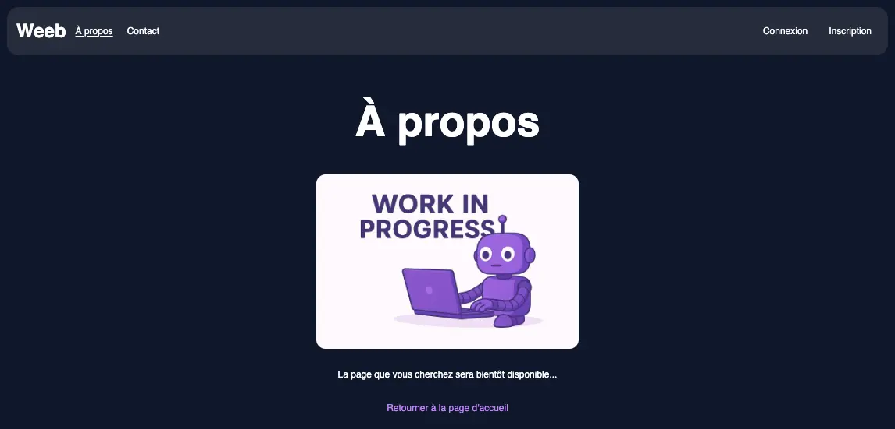

## 🌐 **Weeb**

<p align="center">
  
</p>

## 🧩 Presentation

**Weeb** is a community blog developed as part of the Software Engineer program at DataScientest: a React front-end and a Django REST API, deployed in production with an automated DevOps pipeline.

🎯 **Goal n°1**: implement the Home, Contact, and Login pages, to create solid foundation for future features (blog, authentication, ...).

🎯 **Goal n°2**: implement Blog, Article, and Profile pages. A user can:

- send a review (not authenticated)
- read all articles (not authenticated)
- create, update, delete an article (authenticated and author)
- update profile infos and reset password (authenticated)

🎯 **Goal n°3**: make the application deployable, tested, automatically delivered and monitored (DevOps).

<p align="center">
  
  
  
  
  
  
  
  
  
  
  
  
</p>

## 🔗 Production

| Component              | Platform              | URL                                                                       |
| ---------------------- | --------------------- | ------------------------------------------------------------------------- |
| Front-end (React)      | Vercel                | https://lb-weeb.vercel.app                                                |
| API (Django in Docker) | Render                | https://lb-weeb-api.onrender.com                                          |
| API health check       | Render                | https://lb-weeb-api.onrender.com/health/                                  |
| Database               | Supabase (PostgreSQL) | private, reached by the API only (Session pooler, TLS)                    |
| Images / e-mails       | Cloudinary / Mailtrap | managed services (e-mails are captured in the Mailtrap sandbox, not sent) |

Users only use the front-end URL: Vercel proxies `/api/*` calls to the Render API (`weeb_frontend/vercel.json`), so the front-end and the API share the same domain for the browser and the httpOnly authentication cookies work.

## ⚙️ Tech Stack

Application

- React - UI framework
- TypeScript - Static typing
- TailwindCSS - Utility first CSS framework
- Framer Motion - Animations
- Django & Django REST Framework - REST API
- Simple JWT - authentication (tokens in httpOnly cookies)
- PostgreSQL (Supabase) - Database
- Mailtrap - Email testing & sandbox
- Cloudinary - Image & media storage

DevOps

- Git & GitHub - Version control, issues, Pull Requests, protected `main` branch
- python-decouple - configuration through environment variables
- Gunicorn & WhiteNoise - production server and static files
- Docker - API container (`python:3.13.7-slim`, non-root user)
- pytest & pytest-django - back-end tests
- Vitest & React Testing Library - front-end tests
- GitHub Actions - CI/CD pipeline
- Render & Vercel - hosting
- UptimeRobot, Sentry, Lighthouse - monitoring

## 🚀 Installation

Prerequisites: Git, Node.js 20, Python 3.13.7, Docker Desktop (for the test database and the API image).

1. Clone the repository :

```bash
git clone https://github.com/LucileBch/weeb_lucile_bouchire.git
cd weeb_lucile_bouchire
```

### Front-end

2. Install dependencies :

```bash
cd weeb_frontend
npm install
```

3. Create the .env file from .env.example :

```bash
cp .env.example .env
```

👉 In development: `VITE_API_URL=http://localhost:8000/api` (leave `VITE_SENTRY_DSN` empty)

4. Run frontend :

```bash
npm run dev
```

👉 Open in your browser: http://localhost:5173

### Back-end

5. Create virtual environment & install dependencies :

```bash
cd ../weeb_api
python3 -m venv env
source env/bin/activate
pip install -r requirements.txt
```

6. Create and complete the .env file from .env.example :

```bash
cp .env.example .env
```

👉 Configure:

- Django secret key
- JWT settings
- Supabase / PostgreSQL database (`DB_*`, Session pooler host)
- Mailtrap SMTP
- Cloudinary credentials

⚠️ Write `KEY=value`: no spaces around `=` and no quotes (required by `docker run --env-file` and by Render).

7. Run migrations & create superuser :

```bash
cd api
python manage.py migrate
python manage.py createsuperuser
```

8. Run backend :

```bash
python manage.py runserver
```

👉 Open in your browser: http://127.0.0.1:8000 (API root), http://127.0.0.1:8000/admin/ (administration)

## ⚙️ Configuration

Settings are split by environment in `weeb_api/api/api/settings/`:

| File             | Used by                             | Content                                                                         |
| ---------------- | ----------------------------------- | ------------------------------------------------------------------------------- |
| `base.py`        | every environment                   | common settings, read from environment variables                                |
| `development.py` | `runserver`, local Docker (default) | `DEBUG=True`, localhost origins                                                 |
| `production.py`  | Render (`DJANGO_SETTINGS_MODULE`)   | `DEBUG=False`, allowed hosts, HTTPS / HSTS, secure cookies, WhiteNoise, Sentry  |
| `test.py`        | pytest (`pytest.ini`)               | local PostgreSQL, in-memory files, e-mails kept in memory, fast password hasher |

All environment variables are listed and described in `weeb_api/.env.example` and `weeb_frontend/.env.example`. No secret is written in the code: real values are only stored in the local `.env` files (ignored by Git), on Render, on Vercel and in GitHub secrets.

## 🧪 Tests

### Back-end (pytest)

Tests run on a local PostgreSQL 17 container, never on Supabase:

```bash
docker run -d --name weeb-test-db -e POSTGRES_PASSWORD=postgres -p 5433:5432 postgres:17
```

Then, from `weeb_api/` with the virtual environment activated:

```bash
pip install -r requirements-dev.txt
pytest
pytest --cov
```

👉 25 tests (unit and integration), 74 % coverage. Next times: `docker start weeb-test-db`.

### Front-end (Vitest)

From `weeb_frontend/`:

```bash
npm run lint
npm test -- --run
npm run coverage
npm run build
```

👉 23 tests (unit and component). `npm test` without `--run` starts the watch mode.

## 🐳 Docker

Only the API is containerised (`weeb_api/Dockerfile`). The front-end is a set of static files served by the Vercel CDN, and the data live in managed services (Supabase, Cloudinary): the container is stateless.

Build the image (from the repository root):

```bash
docker build -t weeb-api ./weeb_api
```

Run it with the local .env (development settings):

```bash
docker run --rm --env-file weeb_api/.env -p 8000:8000 weeb-api
```

👉 Open in your browser: http://localhost:8000/health/

At startup the container applies the migrations, collects the static files, then starts Gunicorn on `$PORT` (8000 by default) as a non-root user. Secrets are never copied into the image (`.dockerignore`): they are given at runtime as environment variables.

## 🔄 CI/CD

The pipeline is defined in `.github/workflows/ci-cd.yml`. It runs on every Pull Request to `main` and on every push to `main`.

| Job                            | Steps                                                        | Runs on   |
| ------------------------------ | ------------------------------------------------------------ | --------- |
| Back-end (pytest)              | Python 3.13.7, pip cache, pytest + coverage on PostgreSQL 17 | PR + main |
| Front-end (lint, tests, build) | Node.js 20, npm cache, ESLint, Vitest, production build      | PR + main |
| Image Docker (back-end)        | `docker build` of the API image                              | PR + main |
| Déploiement back-end (Render)  | calls the Render Deploy Hook (`needs` the three jobs above)  | main only |

- The `main` branch is protected: no direct push, Pull Request required, the three CI jobs must pass before merging.
- The API is deployed only by the pipeline: Render auto-deploy is disabled, and the Deploy Hook URL is stored in the GitHub secret `RENDER_DEPLOY_HOOK_URL`.
- The front-end is deployed by Vercel from the protected `main` branch.
- Tests use placeholder values for the required settings: no real secret is used by the CI.

Workflow: create an issue → create a branch named by type (`feat/`, `fix/`, `chore/`, `build/`, `test/`, `ci/`, `docs/`) → open a Pull Request → CI → merge → deployment.

## 🚢 Deployment

### API on Render (Docker)

- Root Directory: `weeb_api`, Dockerfile: `./Dockerfile`
- Environment variables: all the variables of `weeb_api/.env.example`, plus `DJANGO_SETTINGS_MODULE=api.settings.production`, `ALLOWED_HOSTS`, `CORS_ALLOWED_ORIGINS`, `FRONTEND_URL`, `SENTRY_DSN`
- `DB_*`: Supabase production project, Session pooler (Render has no IPv6)
- Auto-Deploy: Off (deployment triggered by the CI Deploy Hook)

### Front-end on Vercel

- Root Directory: `weeb_frontend` (Vite preset)
- Environment variables: `VITE_API_URL=/api`, `VITE_SENTRY_DSN` (production only)
- `vercel.json`: `/api/*` proxied to the Render API, every other route served by `index.html` (React Router)

⚠️ `VITE_*` variables are embedded in the JavaScript at build time: after changing one on Vercel, redeploy.

### Rollback

- Front-end: Vercel → Deployments → promote the previous deployment.
- API: revert the faulty Pull Request on GitHub (Revert button): the pipeline tests and deploys the previous code.
- The API container is stateless: redeploying it never loses data.

## 📈 Monitoring

| What                       | Tool                                          | Alert                            |
| -------------------------- | --------------------------------------------- | -------------------------------- |
| API and database available | UptimeRobot on `/health/`, every 5 minutes    | e-mail when down and back up     |
| Front-end available        | UptimeRobot on the home page, every 5 minutes | e-mail when down and back up     |
| API errors                 | Sentry (project `weeb-api`)                   | e-mail on new / regressed issues |
| Browser errors             | Sentry (project `weeb-front`)                 | e-mail on new / regressed issues |
| Performance, accessibility | Lighthouse (manual audit, mobile)             | -                                |
| Logs and bandwidth         | Render dashboard                              | e-mail on failed deployment      |

`/health/` runs `SELECT 1` on the database: `200 {"status": "ok"}` if everything works, `503` if the database is unreachable.

Sentry is enabled in production only, when `SENTRY_DSN` / `VITE_SENTRY_DSN` are set. No personal data is sent (no IP address, e-mail or cookies) and 20 % of the requests are traced.

## 🛣️ Main routes

API

| Route            | Description                               |
| ---------------- | ----------------------------------------- |
| `/`              | API welcome message (useful links)        |
| `/health/`       | health check (API + database)             |
| `/admin/`        | Django administration                     |
| `/api/signup/`   | sign up (account activated by an admin)   |
| `/api/auth/...`  | login, refresh token, logout              |
| `/api/users/...` | profile, forgot password (code by e-mail) |
| `/api/articles/` | articles (read: everyone, write: author)  |
| `/api/reviews/`  | reviews                                   |

## 🗂️ Structure

```bash
weeb_lucile_bouchire/
├── .github/workflows/
│   └── ci-cd.yml        # CI/CD pipeline (GitHub Actions)
├── weeb_frontend/       # React application (deployed on Vercel)
└── weeb_api/            # Django API (Docker image deployed on Render)
```

Frontend

```bash
weeb_frontend/
├── src/
│   ├── app/
│   │   ├── router/         # router configuration
│   │   └── layouts/        # global layouts
│   ├── assets/             # images, icons, logos
│   ├── components/         # reusable components (+ *.test.tsx)
│   ├── core/               # api, contexts, hooks, utils, dtos (+ *.test.ts)
│   ├── pages/              # main pages
│   ├── index.css           # main style sheet (Tailwind theme)
│   ├── setupTests.ts       # test setup (jest-dom matchers)
│   └── main.tsx            # entry point (Sentry init in production)
├── .env.example         # environment variables
├── vercel.json          # API proxy + SPA fallback
└── vite.config.ts       # Vite and Vitest configuration
```

Backend

```bash
weeb_api/
├── api/                    # Django project (folder containing manage.py)
│   ├── api/                # main project configuration
│   │   ├── settings/          # base, development, production, test
│   │   ├── authentication.py  # custom JWT cookie authentication
│   │   ├── permissions.py     # custom user permissions
│   │   ├── views.py           # API root and health check
│   │   ├── urls.py            # root api routes
│   │   ├── asgi.py / wsgi.py  # ASGI / WSGI config
│   │   └── test_health.py     # tests
│   ├── articles/           # articles app
│   │   ├── admin.py           # admin config
│   │   ├── models.py          # database models
│   │   ├── serializers.py     # DRF serializers
│   │   ├── urls.py            # articles routes
│   │   ├── views.py           # API views / logic
│   │   └── test_api.py        # tests
│   ├── reviews/            # reviews app (same)
│   ├── users/              # users app (same + validators, signals, tests)
│   ├── conftest.py         # pytest fixtures
│   └── manage.py
├── Dockerfile              # API image
├── .dockerignore           # files kept out of the image (.env, venv, tests)
├── .env.example            # environment variables
├── pytest.ini              # pytest configuration
├── requirements.txt        # production dependencies
└── requirements-dev.txt    # test dependencies
```

## 🧱 Next steps

- [x] implement backend (Python & Django Rest Framework)
- [x] implement database (PostgreSQL - Supabase)
- [x] DevOps: production settings, deployment, Docker, tests, CI/CD, monitoring
- [ ] end-to-end tests (Cypress / Playwright)
- [ ] real e-mail delivery (transactional e-mail provider)
- [ ] Docker Compose for a fully local environment (API + PostgreSQL)

## 👩‍💻 Contributors

- [@LucileBouchire](https://github.com/LucileBch) (main developer)

## 🙏 Thanks

Thanks to :

- [@DataScientest](https://datascientest.com)
